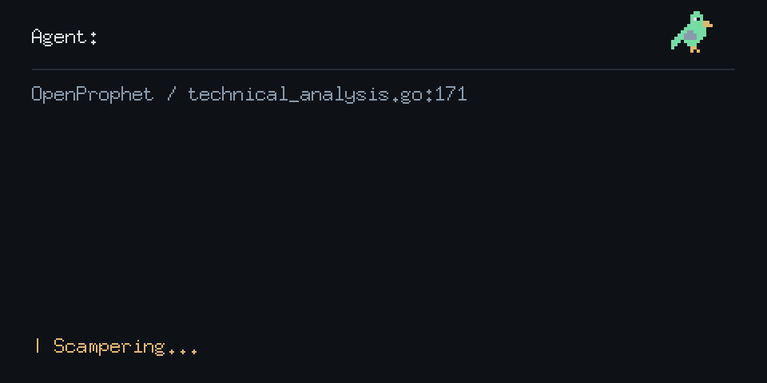

<!-- profile-terminal:start -->

<!-- profile-terminal:end -->

### Notable Repo Contributions:

<a href="https://github.com/golang/go"> <strong>golang/go</strong></a>

- [cmd/compile: avoid revisiting shared OR expressions](https://github.com/golang/go/commit/542b6fe3e77e1d406f24fb4c9aa02284f5ee4679)
- [cmd/compile: remove the fallback jump-table branch scan](https://github.com/golang/go/commit/0c9cdd6a165e85e79369e43eec465ea5699de098)
- [cmd/compile: avoid scanning direct jump-table branches](https://github.com/golang/go/commit/9383561a67f6056198aebb2ecb2da727daa5e7cb)

Go gopher by [Renee French](https://go.dev/blog/gopher), [CC BY 4.0](https://creativecommons.org/licenses/by/4.0/).

### Notable Repos

- [OpenProphet](https://github.com/JakeNesler/OpenProphet)
- [yscale](https://github.com/Yscale-sh/yscale)
